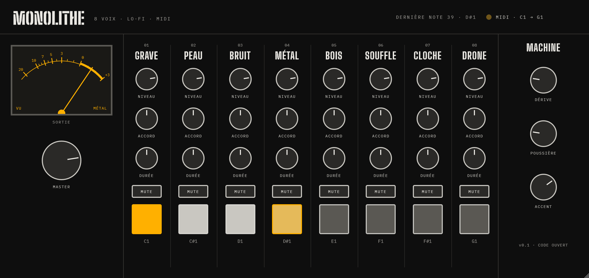

# MONOLITHE

**English** · [Français](README.fr.md)

A lo-fi, 8-voice drum machine plugin, played from your DAW's MIDI.
Free and open source (AGPLv3). VST3 for Windows and macOS, AU for macOS.



MONOLITHE started as a hardware analog drum machine. This plugin is its software version: eight voices freely
inspired by the circuits of the hardware design (bridged-T resonators, 808-style metal, noise), a front panel
with no menus, and a MACHINE section that makes it sound like an old, slightly tired box.

## The voices

Each voice listens to one MIDI note, starting at **C1 (MIDI note 36)**, the layout of an Ableton Drum Rack.

| Note | Voice | Sound | ACCORD (tuning) | DURÉE (length) |
|---|---|---|---|---|
| C1 (36) | **01 GRAVE** | Deep struck resonator with a pitch drop, saturated | 36 – 87 Hz | 0.15 – 1.6 s |
| C#1 (37) | **02 PEAU** | Drum skin: two body modes plus a noise snap | 120 – 260 Hz | 50 – 250 ms |
| D1 (38) | **03 BRUIT** | Noise through a tuned band-pass (shaker, hat) | 500 Hz – 9 kHz | 30 – 600 ms |
| D#1 (39) | **04 MÉTAL** | Six square waves at the 808 cymbal ratios | one octave down / up | 30 – 900 ms |
| E1 (40) | **05 BOIS** | Short wooden knock | 400 Hz – 2.5 kHz | 20 – 250 ms |
| F1 (41) | **06 SOUFFLE** | Filtered breath that swells then fades | dark – bright | 0.2 – 3 s |
| F#1 (42) | **07 CLOCHE** | Two oscillators a fifth apart, 808-style cowbell | 270 Hz – 1.1 kHz | 80 ms – 1.2 s |
| G1 (43) | **08 DRONE** | Two slowly beating oscillators, held while the note is held | 40 – 160 Hz | release 0.1 – 4 s |

Some DAWs call MIDI note 36 "C2" instead of "C1": the note number is what counts.

## Controls

**Per voice**
- **NIVEAU** – level of the voice.
- **ACCORD** – tuning (see the table above).
- **DURÉE** – length of the sound (release time for DRONE).
- **MUTE** – silences the voice.
- **Pad** – click it to hear the voice. Pads light up in amber while their voice sounds.

**MACHINE**
- **DÉRIVE** (drift) – analog instability. Each hit comes out slightly different (pitch, length, strength), and each voice slowly wanders out of tune and back, like circuits warming up. 0 = perfectly steady.
- **POUSSIÈRE** (dust) – lo-fi. Fewer bits (down to 8), lower sample rate (down to 6 kHz), darker tone, tape hiss and the odd vinyl crackle. 0 = clean.
- **ACCENT** – how much the MIDI velocity matters. 0 = every hit at full strength, 1 = fully dynamic.

**Output**
- **MASTER** – output level. A soft saturation keeps the sum from clipping.
- The **VU meter** follows the output and shows the last voice played.

Every control can be automated. Knobs: drag up/down or use the mouse wheel, double-click to reset.
The window can be resized from 75 % to 200 % (bottom-right corner).

## Installation

Download the latest version from the [**Releases**](../../releases) page.

**Windows** – unzip and copy `MONOLITHE.vst3` into `C:\Program Files\Common Files\VST3\`
(create the folder if it does not exist; Windows will ask for administrator rights).

**macOS** – unzip and copy:
- `MONOLITHE.vst3` into `~/Library/Audio/Plug-Ins/VST3/`
- `MONOLITHE.component` (AU) into `~/Library/Audio/Plug-Ins/Components/`

The plugin is not signed by Apple. If macOS blocks it, open Terminal and run:

```
xattr -dr com.apple.quarantine ~/Library/Audio/Plug-Ins/VST3/MONOLITHE.vst3
xattr -dr com.apple.quarantine ~/Library/Audio/Plug-Ins/Components/MONOLITHE.component
```

> ⚠️ **The macOS version has not been tested on a real Mac yet.** It is built and checked automatically
> (pluginval and Apple's auval), but no one has played it in a DAW. Feedback is very welcome:
> please open an [issue](../../issues).

Then rescan your plugins in your DAW. MONOLITHE appears as an instrument (category *Drum*).

## Tip for Ableton Live 11: drum names instead of a piano

Ableton only shows drum names in the MIDI editor for its own Drum Rack. To see "01 GRAVE", "02 PEAU"… instead of piano keys:

1. Create a MIDI track named, for example, *MONOLITHE notes*, and put an empty **Drum Rack** on it.
2. On pads C1 to G1: drop any sample, rename the chain (01 GRAVE, 02 PEAU, 03 BRUIT, 04 MÉTAL, 05 BOIS, 06 SOUFFLE, 07 CLOCHE, 08 DRONE), then delete the sample. The empty chain keeps its name.
3. Save this Drum Rack as a preset to reuse it.
4. On the MONOLITHE track, set **MIDI From** to *MONOLITHE notes*, then **Pre FX**, and set monitoring to **In**.
5. Write your clips on the *MONOLITHE notes* track with **Fold** enabled.

Other DAWs that read VST3 note names (e.g. FL Studio, Cubase) show the voice names directly.

## Building from source

Requirements: CMake 3.22+, and Visual Studio 2022 (Windows) or Xcode (macOS).

```
git clone --recursive https://github.com/damcoll/monolithe-vst.git
cd monolithe-vst
cmake -B build
cmake --build build --config Release
```

The plugins are in `build/Monolithe_artefacts/Release/`. Three small tools are built as well:
- `MonolitheRender` – one .wav per voice, to tune the sounds without a DAW;
- `MonolitheDemo` – a pattern played through the whole plugin at several DÉRIVE / POUSSIÈRE settings;
- `MonolitheSnapshot` – a PNG of the plugin window.

## Known limitations

- Mono sound (the same signal on both outputs), no pan per voice.
- No presets and no internal sequencer: the rhythm comes from your DAW.

## License and credits

MONOLITHE is released under the **GNU AGPLv3**, see [LICENSE](LICENSE).

- Built with [JUCE](https://juce.com) (AGPLv3) and the Steinberg VST3 SDK (MIT).
- Typefaces: [Big Shoulders](https://github.com/xotypeco/big_shoulders) and [IBM Plex Mono](https://github.com/IBM/plex),
  under the SIL Open Font License (see `assets/fonts`).
- Plugins checked with [pluginval](https://github.com/Tracktion/pluginval) by Tracktion.
